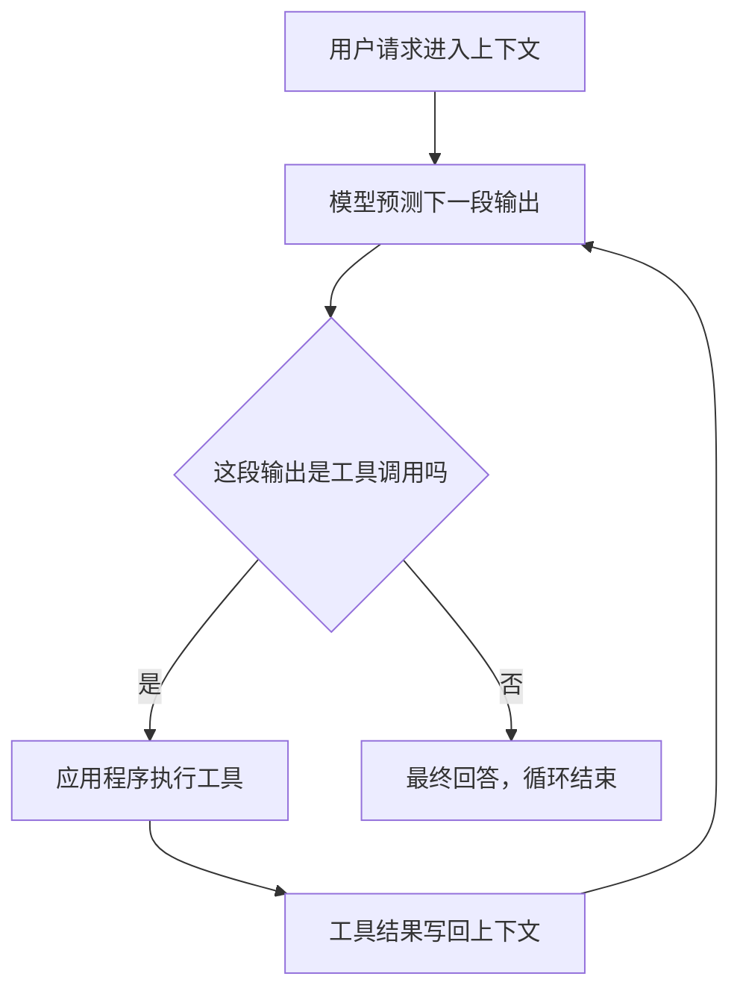

# W01 周一 学习笔记：编码 Agent 是怎么工作的

| 项目 | 内容 |
|---|---|
| 日期 | 2026-11-24 |
| 对应周计划 | [W01 周一](../../docs/周计划/W01-编码Agent的工作方式与Cursor基础.md) |

## 1. 今日学习目标

- [ ] 理解模型是按概率预测文本的，同样的输入不保证同样的输出。
- [ ] 理解上下文窗口是什么、里面装了什么。
- [ ] 理解工具调用的过程，以及 Agent 就是循环里的工具调用。

勾选留到能闭卷讲清楚再打。阅读内容在第 2 节。动手观察还没有，见第 3 节。

## 2. 知识点

### 2.1 模型按概率预测下一个 token

- **是什么**：编码时用的模型，可以看成一个通用接口：给它一段输入（prompt），它接出下一段文本。传统程序是确定的，同一输入再跑一次，输出相同。模型是概率的，同一模型、同一 prompt 可以走出不同路径。
- **解决什么问题**：知道输出不稳定，所以 AI 写的代码要验证，两次结果不同是正常现象，格式约束也可能被忽略。
- **原理**：模型不检索标准答案。它根据两样东西预测下一个 token：训练时见过的模式，以及这次的输入。token 是模型实际处理的片段，一个词可能是一个 token，也可能被拆开；标点和空格也可以单独成 token。
- **例子**：prompt 要求 “What is the meaning of life? Respond with a single word.” 仍可能得到不止一个词，再发一次也可以是另一句。

顺带的选型事实：模型在能力、速度、价格、擅长领域上不同。快而便宜的模型处理不了需要长时间推理的问题；慢而贵的模型可以在复杂任务上多想一会儿。做软件时，还常用三种模态：文字描述需求和计划，图片传达界面稿和视觉反馈，语音转写成长指令。

### 2.2 幻觉和另外两类不可靠

- **是什么**：幻觉是模型用确定的语气写出看起来合理、实际上不存在的内容。另外两类常见不可靠：附和你（你错了它也说 “You're absolutely right”），以及做不好确定程序擅长的事，例如真随机数、数某个字符出现了几次。
- **解决什么问题**：把模型输出当成待核对的草稿。发现假 API、假方法、假配置时，去文档或代码库核对，把报错送回模型，让它按真实错误改。
- **原理**：下一步只是在续写“最像训练数据的内容”。它经常不会停下来承认不知道。训练数据有一个知识截止日期，这之后出现的库，它更容易编一套像样的用法。编辑器里的报错（例如 Cursor 对不存在的 import 标红）就是用来打回模型的反馈。
- **例子**：

```javascript
// 模型建议从 react 导入 debounce
import { debounce } from "react";
// react 不导出 debounce，要用 lodash，或自己写
```

```python
# 模型建议
df.remove_outliers(threshold=3)
# pandas 的 DataFrame 没有这个方法
```

### 2.3 Token、计价和流式输出

- **是什么**：调用按 token 计费，分输入 token 和输出 token。输入包括这次的 prompt 和已有对话；输出是模型新生成的内容。输出 token 的单价通常是输入的 2 到 4 倍。速度用 TPS（tokens per second，每秒生成的 token 数）衡量。
- **解决什么问题**：控制花费和等待。少往初始上下文里塞无关内容，并明确要求回答简练或详细。
- **原理**：模型一个 token 一个 token 地生成，后一个依赖前一个。流式输出是把已经生成的 token 立刻送回来，所以可以不等全文结束，也可以中途打断。流式输出不降低输出 token 的费用。工具侧还会缓存反复出现的 prompt 前缀，减少重复计算的费用；缓存改变的是价钱，这些 token 仍然占上下文窗口。
- **例子**：让模型“只列出函数名，不要解释”，输出 token 会少一截。对话里堆进整个目录的文件，输入 token 和后续每一轮的费用一起涨。

### 2.4 上下文窗口里装了什么

- **是什么**：上下文窗口是模型生成这一次回复时能参考的全部文本，包括它正在生成的回复。这是工作记忆，不是训练用的那批语料。窗口大小因模型而异。
- **解决什么问题**：输出质量主要取决于你放进窗口的内容，而不只是措辞。窗口会满，满了之后工具会拒绝继续、压缩或总结已有对话。
- **原理**：
  1. 窗口从系统提示开始。系统提示由工具作者写入，用来规定风格和规则。
  2. 后面接上用户消息。文字、图片都可以；图片会被模型读进去并占 token。语法不必完整，意图要清楚。
  3. 每一轮的用户消息和助手回复都整段留在窗口里。轮次越多，列表越长。
  4. 一次对话里，模型读得到的至少有这 4 类：系统提示（含规则）、用户消息、已有对话历史、附件与工具相关内容（工具定义、工具结果、被读入的文件）。Cursor 还会按工程状态自动加入打开的文件、终端输出、linter 报错。API key 不在模型可读的上下文里。
  5. 请求里算进窗口的包括：系统提示、每条消息、工具结果、图像和文档、工具定义，以及这一轮的输出（含思考过程）。
  6. token 变多之后，准确率和召回会下降，这叫 context rot。窗口大，不自动等于答得更好。对话变长以后效果变差，原因是旧内容仍占着位置，模型更难用到早先的信息。
- **例子**：先问“设置页在哪”，再问“给它加暗色开关”，再问“补测试”。三次的问句和回答都还在窗口里，再加上每次读文件的结果，占用会明显上升。

### 2.5 工具调用：模型出指令，应用程序去执行

- **是什么**：工具是模型可以请求的一项外部能力。一次工具定义有三部分：名称（如 `read_file`）、描述（何时用、怎么用）、参数（需要哪些输入）。
- **解决什么问题**：模型本身接触不到你的硬盘、终端和网上的新信息。工具让它在对话中途拿到真实结果，再继续生成。写代码时常见的工具：读文件、改文件、搜索代码、跑命令、查文档或网页、跑 linter 和测试。
- **原理**：一次调用是四步。
  1. 模型判断只靠当前上下文不够，需要某项能力。
  2. 模型输出一段 JSON，写明工具名和参数。到这里为止，文件还没被读。
  3. 应用程序执行这个工具，拿到结果。读文件的是 Cursor，不是模型。
  4. 结果写回上下文，模型带着结果继续生成。
- **例子**：

```json
{
  "name": "read_file",
  "description": "Read the contents of a file from the codebase",
  "parameters": {
    "filepath": "The path to the file to read"
  }
}
```

模型若要读按钮组件，会输出类似：

```json
{
  "tool": "read_file",
  "parameters": { "filepath": "src/components/Button.tsx" }
}
```

Cursor 读到文件内容后放进上下文，模型下一轮才看得到 `Button.tsx`。

工具定义放在输入上下文里，每个工具大约几百 token。工具结果再追加进上下文，之后每一轮都会被重新发送。调用越多，窗口填得越快，费用越高。Cursor 在工具调用后会把直到这次调用为止的上下文再送给模型，因此缓存的输入 token 会变多。

MCP（Model Context Protocol）是连接外部工具的一套通用协议，作用类似给模型用的 USB。同一个 MCP 工具可以接到不同的 AI 应用上，例如设计稿、议题、数据库。周一只要知道它是工具的标准接口；怎么装、怎么选，是周五的内容。

### 2.6 Agent 是放在循环里的工具调用

- **是什么**：Agent 让模型自己决定下一步调哪个工具、要不要再调，而不是你逐步下命令。你给目标，它拆步骤。Cursor 里用 `Ctrl+I` 打开侧边栏里的 Agent。
- **解决什么问题**：少做“先问有哪些文件、再读某一个、再改它”这种一问一答。你改任任务负责人和审查者，实现细节交给循环。多个 Agent 可以同时做不同任务。
- **原理**：循环如下。结束条件也标在图里。



正常结束：模型给出一段不再请求工具的回答。循环还会从外面被停掉：你中途打断，上下文窗口装不下，或者工具执行失败。Cursor 不限制单次任务里的工具调用次数，所以不会因为“调太多次”自动停。

适合交给它的：跨很多文件、模式固定的重构；给一个范围清楚、已经能复现的错误补测试；按现有风格改文档；根据明确报错修 bug。

不适合直接放手的：要理解多系统交互的复杂调试；按复杂设计稿做到像素级还原；训练数据里没有、又没有文档的新库。它还会重复同一套失败做法，形成空转。约束要可检查，例如合并前测试必须通过。只说“小心一点”约束不住它。

token 消耗会明显高于一次普通问答，因为每次工具调用都在加上下文。它也可能改出你没要求的内容。代码是否正确、是否符合标准，仍然由你确认。先交小而边界清楚的任务，中间设检查点，再扩大范围。

- **例子**：目标是“给设置页加一个暗色开关”。循环里可能依次发生：搜索设置页 → 读相关文件 → 自己列出实现步骤 → 改状态、样式和组件 → 跑测试 → 按报错再改 → 直到不再调工具、给出总结。

### 2.7 Cursor Agent 的三部分和自带工具

- **是什么**：Cursor 的 Agent 由三部分拼成。指令：系统提示和规则。工具：搜代码、改文件、跑终端等。模型：你为这次任务选的那个模型。
- **解决什么问题**：换模型时，你仍用同一套“下目标、看工具、查结果”的方式。Cursor 按不同模型调整指令和工具，模型本身的差异由它消化。
- **原理**：没有这三部分里的工具，模型只能在已有上下文里生成文字。有了工具，才进入 2.6 的循环。较大的一块工作可以建成 Project：一个负责协调的 Agent 做计划，再分给其他 Agent。
- **例子**：文档列出的工具有：搜索文件和文件夹、Web、Fetch Rules、读文件、改文件、跑 shell、浏览器、生成图片、向你提问。Fetch Rules 会把规则取进上下文，规则怎么写是周三的内容。

## 3. 动手记录

周计划周一的四项动手任务，原材料里没有过程，这里没有观察数据。

- [ ] 向 Agent 提一个必须读文件才能回答的问题。
- [ ] 展开每一步工具调用，记下工具名、顺序、每一步拿到了什么。
- [ ] 看输入框旁的上下文占用环，记下哪几类内容占了窗口。
- [ ] 不看资料画出循环图，并标出循环在什么条件下结束。第 2.6 节的图是阅读整理的参考图。

- **代码或文件位置**：无
- **做了什么**：无记录
- **结果**：无
- **踩的坑和解决办法**：无记录

## 4. 资料记录

| 资料 | 看到哪里 | 评价 |
|---|---|---|
| [AI 模型如何工作](https://cursor.com/cn/learn/how-ai-models-work) | 必读全文：概率预测、幻觉、token、流式输出 | 要点已在 2.1–2.3。以后只回看幻觉例子 |
| [上下文](https://cursor.com/cn/learn/context) | 必读全文：系统提示、用户消息、窗口变长 | 要点已在 2.4。和下面 Claude 那页有重叠 |
| [工具调用](https://cursor.com/cn/learn/tool-calling) | 必读全文：四步、三个组成部分、token 成本、MCP 一段 | 要点已在 2.5。MCP 周五再读 |
| [智能体](https://cursor.com/cn/learn/agents) | 必读全文：擅长和不擅长、委托方式 | 要点已在 2.6 |
| [Cursor 智能体](https://cursor.com/cn/docs/agent/overview) | 必读的“工作原理”和“工具” | 要点已在 2.7。原材料在工具列表处结束 |
| [上下文窗口](https://platform.claude.com/docs/zh-CN/build-with-claude/context-windows) | 选读，要求只看“工作原理” | 工作原理已并入 2.4。后文的模型表、思考块保留规则、压缩 API 周一用不上 |
| [Hello-Agents 第一章](https://datawhalechina.github.io/hello-agents/) | 选读，未读 | 周一不阻塞。想对照“智能体”定义时再看 |
| [How to Build an Agent](https://ampcode.com/how-to-build-an-agent) | 选读，未读 | 周一浏览即可。W15 才会自己写 |
